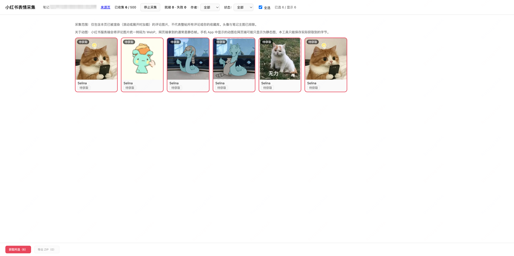

# 小红书表情包导出（Chrome / Edge 扩展）

> 把小红书评论里已经渲染出来的表情图片，预览、筛选后批量导出到本地。

[](https://developer.chrome.com/docs/extensions/develop/migrate)
[](https://www.google.com/chrome/)
[](#开发者说明)
[](#许可)



## 为什么需要它

小红书的个人收藏表情只能在手机端APP显示，但无法导出；而网页端可以直接下载评论区表情包，但无法展示个人收藏表情包，评论区逐个下载也较为麻烦。

所以本工具旨在通过浏览器插件的形式，将网页端表情包下载/全流程自动化，自动识别指定帖子中评论区所有表情包，并根据个人需求自选对应表情包进行下载，流程如下：

> 手机端把想导出的表情发到一条帖子评论里 → Chrome / Edge 浏览器打开帖子 → 扩展收集、预览、导出


## 功能概览

**采集**

- 只扫描笔记详情页评论区，自动排除头像、笔记主图、界面图标
- 采集开始后增量捕获新渲染的评论图片（滚动 / 展开评论时自动进入列表）
- 记录评论 ID 与**稳定作者 ID**，同名作者不会合并
- 切换笔记、刷新页面、关闭标签页时明确提示，不把不同帖子混在一起

**筛选与预览**

- 网格预览，缩略图直接显示原图
- 按作者筛选（可选"仅该作者独立评论"，用于排除回复中的图片）
- 按状态筛选（全部 / 已就绪 / 失败）、全选、单选
- 默认全选，新图片到达时自动勾选

**导出**

- 单张保存，或批量导出 ZIP
- 按字节签名识别 PNG / JPEG / GIF / WebP / AVIF，不轻信扩展名与 Content-Type
- **SHA-256 内容去重**：字节相同的图片只输出一份，所有来源保留在 manifest 中
- 动画状态如实标注：动图 / 静态 / 动态未知
- 失败项单独记录原因，可一键重试
- ZIP 结构：

```text
rednote-emoji_<noteId>_<时间戳>/
  images/
    0001_<hash前12位>.webp
    0002_<hash前12位>.png
  manifest.json     # 哈希、格式、尺寸、动画状态、作者/评论来源、去重映射
  failures.json     # 未导出项及原因
```

**稳定性**

- 下载队列并发 3，瞬时失败自动重试 2 次
- 支持中途取消；刷新管理页后自动恢复可重试状态
- 多个管理页同时打开时，通过租约只允许一个执行队列，避免重复下载
- 任务在管理页执行，不依赖 service worker 常驻

## 下载与安装

> 浏览器扩展无法像普通 App 那样双击直接注册进 Chrome / Edge，需要进行手动在浏览器扩展页导入拓展。

### macOS（推荐）

1. 下载 `RednoteEmoji-<版本>.dmg`（见 Releases；若从聊天工具获取不便，也可用同名的 `.zip` 传输后解压，内容相同）
2. 双击挂载，把「**安装小红书表情包导出**」拖进「应用程序」
3. 双击运行。首次若提示"无法验证开发者"，请 **右键 → 打开**
4. 安装程序会：
   - 把扩展复制到 `~/Library/Application Support/RednoteEmoji/extension`
   - 把该路径复制到剪贴板
   - 打开浏览器扩展管理页
5. 在扩展管理页（`chrome://extensions` 或 `edge://extensions`）：
   - 打开右上角「**开发者模式**」
   - 点击「**加载已解压的扩展程序**」
   - 在文件选择框按 **⌘⇧G**，⌘V 粘贴路径，回车，选择该文件夹

卸载：

```bash
rm -rf ~/Library/Application\ Support/RednoteEmoji
```

并在扩展管理页点「移除」。

### 从源码构建（Windows / Linux / 不想用安装包）

需要 [Node.js](https://nodejs.org/) ≥ 20。

```bash
git clone <本仓库地址>
cd export-rednote-emoji
npm install
npm run build        # 产物在 dist/
```

然后在扩展管理页（`chrome://extensions` 或 `edge://extensions`）：

1. 打开右上角「**开发者模式**」
2. 点击「**加载已解压的扩展程序**」
3. 选择项目下的 **`dist/`** 目录

> 修改代码后重新执行 `npm run build`，再到扩展管理页点扩展卡片上的「重新加载」即可生效。

卸载：在扩展管理页点「移除」，然后删除克隆下来的仓库目录。

### 版本要求

| 项目 | 要求 |
|---|---|
| 浏览器 | Chrome ≥ 120（实测 155.0.8059.85） / Edge ≥ 120（待实测） |
| 系统 | macOS 11+（仅安装器）；扩展本身跨平台 |

## 使用

1. **手机**：把要导出的收藏表情发到一条方便管理的帖子评论里（可见性遵循平台规则）。
2. **浏览器**：打开该帖子，手动展开评论与回复，让目标图片渲染出来。
3. 点击工具栏扩展图标：
   - 首次会请求读取小红书图片域名（`sns-webpic-qc.xhscdn.com`）的权限，请允许；
   - 自动打开管理页并开始采集，图标角标变为 ●。
4. 在管理页：
   - 按作者筛选，勾选需要的图片；
   - 点「**获取所选**」读取并校验字节（此时才真正下载，显示格式、尺寸、动画状态、SHA-256）；
   - 单张点「保存」，或点「**导出 ZIP**」批量保存。
5. 需要更多图片，回到小红书标签页滚动或展开评论，管理页会自动更新。
6. 结束点「**停止采集**」。

> **管理页打开后评论区消失是正常现象**：切走标签页会让小红书关闭详情弹层、卸载评论 DOM。
> 已采集的数据已保存在扩展本地，仍可获取与导出；要继续采集，回到小红书页重新展开评论即可。

## 已知限制

- **只采集已渲染的内容**：未滚动到的评论、已被虚拟列表移除的评论、采集开始前卸载的评论都不会出现。
  它不等于整帖所有评论，更不等于手机 App 里的收藏库。
- **动图会被服务端转成静态图**：小红书把评论图片统一转码为 WebP，网页端拿到的通常不含动画帧
- **链接有时效**：图片地址带日期路径段，过期后请求会失败，需回到页面重新加载并重新采集。
- **单次上限**：每个会话最多 500 个候选；单文件 20 MiB；单次 ZIP 最多 200 张或 100 MiB 原始数据。
- **连接中断**：刷新小红书页面、或在 SPA 中切换笔记后，需要重新点击扩展图标开始新会话。
- 导出的是平台当前提供的字节，**不承诺是上传时的原始分辨率**。

## 隐私与权限

扩展申请的最小权限：

| 权限 | 用途 |
|---|---|
| `activeTab` | 点击图标后访问当前标签页 |
| `scripting` | 按需注入采集脚本 |
| `storage` | 保存少量偏好与临时状态 |
| `downloads` | 保存图片与 ZIP |
| `host_permissions: https://sns-webpic-qc.xhscdn.com/*` | 读取已登记候选的图片字节 |

- 不申请 `<all_urls>`，不读取 Cookie，不登录，不上传任何数据到第三方。
- 只在用户点击后注入脚本；只读取当前页的评论图片。
- 通讯消息校验 tab / 会话 / 笔记归属，旧页面的结果不会写入新会话。
- 下载接口只接受已登记的候选 ID，网页消息无法指定任意 URL 或文件路径。
- ZIP 的 `manifest.json` 不包含带签名的资源地址、Cookie 或完整评论文本。

## 常见问题

**Q：为什么评论区明明有表情，却只采集到一部分？**
A：只采集"已经出现在页面上"的图片。请在小红书页面继续向下滚动，或在管理页点状态筛选查看。
如果提示某些图片域名未授权，说明站点换 CDN 了，需要更新扩展允许列表。

**Q：为什么手机上的动图导出后是静态的？**
A：见「已知限制」。这是小红书的服务端转码，不是扩展的问题。

**Q：点保存后没反应 / 提示失败？**
A：看卡片上的错误文本。`403` 通常是链接过期或需要重新加载页面；网络错误会在自动重试 2 次后报告。

**Q：会把同一个表情导出很多次吗？**
A：不会。候选层按 URL 去重，文件层按 SHA-256 去重；重复图片只写一个文件，来源全部记在 `manifest.json`。

**Q：管理页刷新后数据会丢吗？**
A：不会。会话、候选、已获取的图片字节都存在 IndexedDB；刷新后自动恢复，未完成项回到可重试状态。

## 开发者说明

### 技术栈

TypeScript · React 19 · Vite · fflate · Vitest + jsdom · Manifest V3

### 目录结构

```text
src/
  background/   # 点击入口、按需注入、消息与下载事件路由
  content/      # 评论区适配器、增量 observer、页面生命周期
  manager/      # React 管理页、获取队列、ZIP 导出
  workers/      # ZIP 打包工作线程
  services/     # 字节获取、格式嗅探、哈希、IndexedDB、租约
  shared/       # 类型、协议、URL/文件名校验、导出计划
public/         # manifest.json 与图标
scripts/        # 构建、打包、安装器
tests/          # fixtures 与单元测试
docs/           # 安装、使用、验证记录
```

### 常用命令

```bash
npm install
npm run typecheck   # 类型检查
npm test            # 49 项单元测试
npm run build       # 构建扩展到 dist/
npm run dist:mac    # 生成 macOS 安装包 release/*.dmg
npm run release     # 构建并生成全部发布产物
npm run build:probe # 构建 P0 探针扩展到 dist-probe/
```

### 测试覆盖

单元测试覆盖：格式签名与动画标记（含"载荷中出现 ANIM/acTL 字样不误判"）、URL 白名单、文件名清理与 ZIP 路径安全、候选/字节去重、导出计划限额与 manifest、租约、错误分类（HTML/403/429/空响应/超限/取消）、会话与过期消息隔离。

站点适配的选择器来自真实页面探针，记录在 [`docs/VALIDATION.md`](docs/VALIDATION.md)；DOM fixture 依据该结构手工构造。

### 发布

```bash
npm version patch
npm run release
# release/
#   RednoteEmoji-<版本>.dmg   # 双击安装
#   RednoteEmoji-<版本>.zip   # 同一安装器的打包，仅用于传输
```

## 文档

- [安装说明](docs/INSTALL.md)
- [使用说明](docs/USAGE.md)
- [技术方案](TECHNICAL_DESIGN.md)
- [验证记录](docs/VALIDATION.md)（含真实 DOM、CDN 与格式结论）

## 免责声明

本项目仅用于个人备份自己可见、可正常访问的图片，不提供绕过登录、权限或风控的能力。
请遵守小红书的服务条款与相关法律法规；因使用产生的风险由使用者自行承担。

## 许可

暂未选择开源许可（All rights reserved）。如需以开源方式分发，请先补充 LICENSE。
